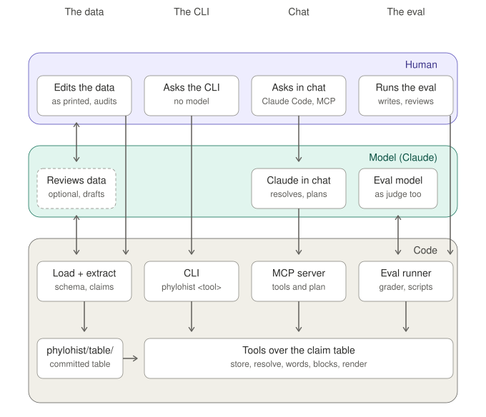

# Phylohist: Exploring changes in systematics over time

Science is always in motion.  Most online taxonomy or phylogeny
databases attempt to show a consensus or accepted view, with
each site having its own editorial policy for what gets included.
Some include historical information, but do not make it a central
or easily-accessible part of the sysetm.

The `phylohist` project instead provides access to trees as published,
over time, while leaving the judgement of what to accept or reject to
the researcher.  An LLM-driven interface supports complex queries over
a curated corpus stored as YAML data.  This uses a model where one is
needed, and prioritizes reliability, reproducibility, speed,
and lower costs where one is not.

The current corpus holds over 200 papers entered in whole or in part, from
the mid-1700s to the present, mostly focusing on Paleozoic echinoderms.
A coverage system tracks how much of the information from a paper has
been entered and reviewed.

## Status and future plans

This repository began as a place to store my notes, and gradually evolved
into a software package, featuring more and more modern software engineering
best practices as I have found time to add them.  However, it remains
a solo, unfunded project that I work on whenever I can.

The package is published on PyPI as `phylohist` from version 0.1.0.
Next steps include writing human-user-friendly documentation,
continuing to improve the software development methodology, curating
additional data and adding more features.

A data model for capturing specimen information has recenlty been
designed but data entry for this area is in its infancy.  Additional
areas of fuure work are proper support for cladograms (currently
allowed in the data but treated more-or-less like systematic trees)
and data visualization.

## Corpus Scope and Editorial Curation Policy

Because `phylohist` relies on manual validation and a human-in-the-loop
workflow, data ingestion proceeds slowly to prioritize high fidelity
over unchecked volume.

No data is entered purely by AI.  The data model has grown from my experience
of manually reading papers and figuring out how to work with the data as
it was published.  Current LLMs are too eager to make things "work" rather
than step back and consider the user experience.

### Intentional Scoping and Partial Entry

Data entry is guided by the target research scope, currently focusing primarily
on Paleozoic echinoderms and their relatives in the Ambulacrarian stem group.

* **Partial Ingestion:** For vast foundational texts such as Linnaeus’s
  *Systema Naturae*, only the specific branches of interest to the active
  dataset are entered.
* **Closed-World Boundaries:** The data model is being enhanced with ways
  to indicate when data is complete by some metric.  However, updating
  the data with these fields is itself a large, ongoing project.

### Archival Fidelity vs. Modern Interpretation

Tracking archaic, text-heavy literature (particularly pre-19th-century sources
written in informal prose) presents a unique archival challenge.

* **Philosophy:** The core directive of this corpus is to capture the published
  author's opinions *as they published them*.  However, no data model is
  perfect, so `phylohist` attempts to get as close as possible while
  capturing literal text and editorial reasoning to inform users of
  possible discrepancies and inferences. Only ICZN-mandated
  textual normalizations are performed.  In more recently-entered data,
  the original textual form is also captured (e.g. "Asterias caputmedusae"
  vs "Aſterias Caput meduſæ").  The common use of only non-Latin names for
  higher taxa in earlier publications introduces further difficulty, as
  does the uneven introduction of ranks other than those first used by Linnaeus.
* **Continuous Ingestion:** Determining how to translate loose, informal
  prose into deterministic YAML schemas without breaking historical context
  is an ongoing design effort.  Often, a paper will inspire a revision
  to the data model, meaning that data entered at different times shows
  different levels of completion.  Older data may use less precise structures
  that will eventually brought in line with the current design so that
  the older structures can be dropped.

*The project welcomes feedback or additions to schemas and coverage maps
via GitHub issues.  Please open an issue prior to working on a pull request
to ensure that the request will be well-received.*

## Corpus Scope and Editorial Curation Policy

The `phylohist` project is a curated, closed-world corpus of historical
taxonomic literature.  Because it relies on deep manual validation and
a human-in-the-loop workflow, data ingestion follows strict boundaries
to maintain high fidelity rather than unchecked volume.

### Intentional Scoping and Partial Entry

Data entry is guided by the target research scope, currently focusing primarily
on Paleozoic echinoderms and to a lesser degree on the early development of
higher-level classification.

* **Partial Ingestion:** For vast foundational texts such as Linnaeus’s
  *Systema Naturae*, only the specific branches of interest to the active
  dataset are entered.
* **Closed-World Boundaries:** If a tool returns a blank result or an
  explicit omission, it indicates that the paper, or the relevant part
  of its contents, have not yet been entered.
* **Iterative Data Modeling:** The initial data model for this project
  was quite simple, and gradually expanded as the experience of working
  with texts made additional needs clear.  Data entered at different
  times shows different levels of completion, and in some cases using
  less precise structures that will eventually be brought in line with
  the current data model.

### Archival Fidelity vs. Modern Interpretation

Tracking archaic, text-heavy literature (particularly pre-19th-century sources
written in informal prose) presents a unique archival challenge. 

* **Philosophy:** The core directive of this corpus is to capture the published
  author's opinions *as they published them*, avoiding retrofitted modern
  consensus or injecting contemporary interpretations.  Only ICZN-mandated
  textual normalizations are performed, and in more recently-entered data,
  the original textual form is also captured (e.g. "Asterias caputmedusae"
  vs "Aſterias Caput meduſæ").  The common use of only non-Latin names for
  higher taxa in earlier publications introduces further difficulty, as
  does the uneven introduction of ranks other than those first used by Linnaeus.
* **Continuous Ingestion:** Determining how to translate loose, informal
  prose into deterministic YAML schemas without breaking historical context
  is an ongoing design effort.  In general, the data model has evolved from
  simplistic beginnings through the experience of manually recording many
  publications across different times, languages, and systematic approaches.
  Data entered earlier on may be incomplete compared to more recent entries,
  or use less precise structures.  These are being upgraded as time and
  resources permit.

*The project welcomes feedback or additions to schemas and coverage maps
via GitHub issues.  Please open an issue prior to working on a pull request
to ensure that the request will be well-received.*

## Humans, Models, and Code

The internet has made a tremendous amount of information available,
but finding what you need and verifying its accuracy is a lot of work.
Humans have the deepest judgement for data curation, while models
handle flexible querying beyond what fixed database queries can provide.
Underneath it all, deterministic code ensures fast, repeatable, and
accurate outcomes.

This diagram shows the roles of humans (the top row), models (the middle)
and code.  The third column shows the expected typical interactive usage,
where the model interprets the questions and chooses the tools to call and
output shapes to render, but leaves the querying and output construction
to code.

This avoids verbose or hallucinated output while spending tokens only
on the work that really requires a model's reasoning and flexibility.

<picture>
  <source media="(prefers-color-scheme: dark)" srcset="https://raw.githubusercontent.com/handrews/phylohist/main/docs/architecture-dark.svg">
  
</picture>

- **The data.** The curator records each publication's opinions as
  printed: who published what systematic information in which paper.
  That is names and nomenclatural acts, placements, usages and
  synonymies, the specimens they rest on with their geological context,
  and the page, plate and figure numbers that locate each of these. It
  is not diagnoses, descriptions or a narration of the paper; a
  researcher who wants those follows the citation to the paper itself.
  The model's part is optional and reviewable: it reads a
  paper against its tree and writes a review (`notes/reviews/`), or
  drafts a tree (`drafts/`) that code validates and the researcher
  audits before it enters `data/`. The human and the model review each
  other's work; code checks both against the schema and regenerates the
  claim table, which CI keeps current.
- **The CLI.** A question goes from the researcher to the tools with no
  model in the lane: `phylohist history rhenopyrgus` renders the block.
- **Chat.** Claude asks the MCP server. The model resolves the
  names and papers the question mentions and states a plan, the blocks
  the answer is made of; code builds and renders them. The model
  chooses; code answers. The only words of the model's own that reach a
  reader are a one-line header stating the parameters it chose.
- **The eval.** The runner drives the model over the committed
  questions in compose or planner mode, the grader is code, and a model
  judges only the header. The researcher writes the questions and
  reviews the grades and write-ups (`eval/`).

## Correctness, Performance, and Cost

The project's evolution can be seen through the evaluation
[metrics](https://github.com/handrews/phylohist/blob/main/eval/findings/metrics.md).

Moving from AI-written prose answers to planned queries with modular
output blocks improved key measurements across complete evaluation runs:

* The measured pass rate rose from 61% to 87% on the original question
  set, with several failure modes eliminated entirely; the latest run
  (2026-11-02, the run version 0.1.0 ships with) passes 80% of those
  questions and 80% of the expanded set of 56.
* Wall clock time was cut from around 25 minutes to around 10 minutes,
  over a quarter more questions.
* Token usage dropped from 2.25 million to 0.60 million.

Future improvements to how the model selects blocks are expected to raise
the correctness score.

## Tools and MCP

The `phylohist` CLI runs queries over the claims table generated from
the curated YAML data.  These result in output data blocks rendered
as text, Markdown, or JSON based on the `--style` argument.

The CLI has one subcommand per tool:

    poetry run phylohist resolve "Palæaster"
    poetry run phylohist contents 1994_guensburg_sprinkle astrocystitidae --synonymy
    poetry run phylohist descendants edrioblastoidea
    poetry run phylohist ancestors astrocystitidae cyathocystidae rhenopyrgidae
    poetry run phylohist history rhenopyrgus --style markdown
    poetry run phylohist history "Rhenopyrgus grayae"
    poetry run phylohist under rhenopyrgus edrioblastoidina
    poetry run phylohist statements "Rhenopyrgus viviani"
    poetry run phylohist gap "Holloway & Jell 1983" material
    poetry run phylohist source "Lamarck 1816"
    poetry run phylohist plan my-plan.yaml
    poetry run python scripts/eval_run.py --mode planner --ask "Who first placed Rhenopyrgus under Edrioblastoidina?"

The same tools are served over MCP by the `phylohist-mcp` command
(`phylohist/mcp.py`), which `.mcp.json` registers for Claude Code:
a chat model can read blocks or state a plan and get the rendered answer.
The "Reading the table" section of `docs/claims.md` describes the blocks
and the tools.

### Tool Examples

What one paper places in a family, showing only what the paper included:

    $ poetry run phylohist contents 1994_guensburg_sprinkle astrocystitidae
    Guensburg & Sprinkle 1994
      Family Astrocystitidae emend.
        Genus Astrocystites
        Genus Cambroblastus
        Genus Lampteroblastus gen. nov.
          Type species. Lampteroblastus hintzei
          Lampteroblastus hintzei sp. nov.

The emendation, the new genus and species, and the type species are the
paper's own statements; nothing here is inferred, and a source whose
listing is not yet entered says so instead.

See [`docs/walkthrough.md`](https://github.com/handrews/phylohist/blob/main/docs/walkthrough.md) for additional examples.

### Asking from the CLI

The `eval_run.py` script can be used to ask a question without using the
chat interface to see how the model plans the queries and selects the output
blocks.  It requires an Anthropic API key to be configured.

    poetry run python scripts/eval_run.py --ask "Who first placed Rhenopyrgus under Edrioblastoidina?"

    Rhenopyrgus (including its subgenus rank variant) placed under Edrioblastoidina (= Edrioblastoidea); taxonomy tree, all years

    Rhenopyrgus Dehm 1961 under Edrioblastoidina Fay 1962: 4 papers, 4 co-author sets, 1994–2020
    first Guensburg & Sprinkle 1994, last Ewin et al. 2020

    1994  Guensburg & Sprinkle  Cyathocystidae › Rhenopyrginae › Rhenopyrgus
    2000  Grigo                 Cyathocystidae › Rhenopyrginae › Rhenopyrgus
    2013  Sumrall et al.        Rhenopyrgidae › Rhenopyrgus
    2020  Ewin et al.           Rhenopyrgidae › Rhenopyrgus

    --- trail
      resolve_name {"query": "Rhenopyrgus"} -> 2 candidate(s)
      resolve_name {"query": "Edrioblastoidina"} -> 1 candidate(s)
      placed_under {"record": "rhenopyrgus", "parent": "edrioblastoidina", "include_variants": true} -> 1 block(s)
      header: Rhenopyrgus (including its subgenus rank variant) placed under Edrioblastoidina (= Edrioblastoidea); taxonomy tree, all years
      21227+375 tokens, 6.9s, tool_use

## Install

From PyPI, for the tools and the MCP server over the claim table as of
the release (Python 3.12 or later):

    pip install phylohist
    phylohist history rhenopyrgus
    phylohist-mcp

The second command is the server over stdio, which any MCP client runs
by name. For Claude Desktop or Claude Code the entry is

    {"mcpServers": {"phylohist": {"command": "phylohist-mcp"}}}

or, with nothing installed, `uvx --from phylohist phylohist-mcp` as the
command and its arguments.

From a checkout, for the loader, the generator and the eval,
[Poetry](https://python-poetry.org/):

    poetry install

The claim table the tools read is generated into `phylohist/table/`, so
a built package carries the table as of its build and a clone answers
from the table as `poetry run regenerate` last wrote it.
`PHYLOHIST_CLAIMS` names another table to read.

Only `scripts/eval_run.py` and the grader's `--judge` call a model;
their client is the `eval` dependency group, and they read
`ANTHROPIC_API_KEY` from the environment or from a git-ignored `.env` at
the repository root. Nothing else needs a key.

## Checks

CI runs these on Python 3.12 and 3.14 and fails if the generated
schema census, the claim table or the expected-warnings file is stale;
after editing `data/` or the schema, `poetry run regenerate` rewrites all
three (a warning the load no longer produces leaves the file; a new one
is added with `scripts/expected_warnings.py --add`):

    poetry run ruff check .
    poetry run ruff format --check .
    poetry run pytest --cov=phylohist --cov-fail-under=90
    poetry run regenerate
    git diff --exit-code scripts/schema-usage.md phylohist/table/ tests/expected-warnings.txt
    poetry run python scripts/check_draft.py drafts/<file>.yaml

The tests run over the frozen copy of the data under `tests/corpus/`;
only those marked `production` load `data/` itself, so improving the
data cannot break a test of the code. `poetry run pytest --demo` adds the
eval questions and the walkthrough over the committed `phylohist/table/`, which
hold for the data they were last refreshed against.

## Where things are

* `docs/` will contain user documentation; for now it explains how
  recorded tree data is converted to the claims that the tools use,
  as well as the tools and the answer formats.
* `notes/` contains project development information from both the human
  and LLM developers; some of this information might be out-of-date.
* `eval/` holds the evaluation questions, results, write-ups, and metrics.
* `drafts/` holds AI-drafted trees awaiting a human audit.

## Licence

`LICENSE` (MIT) covers everything in the repository and in the released
package: the code; the YAML under `data/`, which is the owner's
compilation of published opinions, recorded as printed; the claim table
generated from it; and `notes/`, the owner's and the assistant's writing.
If the corpus is useful in published work, please cite it
(`CITATION.cff`).
